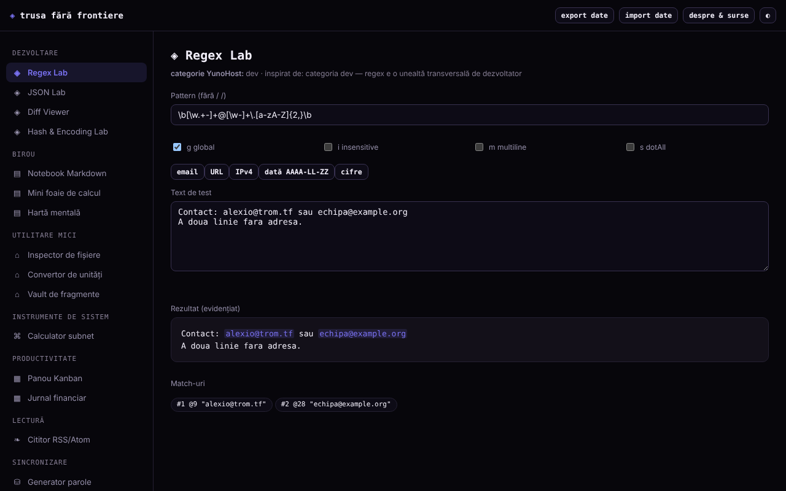

# Trusa fără frontiere

[English](README.md) · [Română](README.ro.md) · [Français](README.fr.md) · [Italiano](README.it.md) · [Español](README.es.md) · [Português](README.pt.md) · **Deutsch** · [Magyar](README.hu.md)

**Version:** 1.2.0 · **Zuletzt aktualisiert:** 2026-10-19

Oberflächensprachen: **Română, English, Français, Italiano, Español, Português (PT), Deutsch, Magyar**

Ein Werkzeugkasten aus 15 kleinen Tools in einer einzigen HTML-Datei: Regex, JSON, Diff, Hash, Passwörter, Subnetz, Notizen, Tabellenkalkulation, Kanban und weitere. Er läuft lokal im Browser, ohne Konto.

**Online-App:** https://chiuta.github.io/Trusa-fara-frontiere/

## Was es ist

Eine Reihe kleiner Module, von Grund auf geschrieben und von der Grundfunktionalität einiger Anwendungskategorien aus dem YunoHost-Katalog inspiriert (Entwicklung, Büro, Dienstprogramme, Systemwerkzeuge, Produktivität, Lesen). Es ist kein Nachbau dieser Anwendungen und nicht mit YunoHost verbunden; Anwendungen, die von einem Server abhängen (Chat, Synchronisierung, Soziales), haben in einer lokalen Datei kein Gegenstück.

## Funktionen

Im Code geprüft und in Headless-Chromium getestet:
- **Regex Lab**: hervorgehobene Treffer, Gruppen (auch benannte), Flags g/i/m/s/u, Vorschau der Ersetzung (`$1`, `$<Name>`, `$&`, `$$`, `` $` ``, `$'`); läuft in einem Worker mit einer Grenze von 1,5 s, damit ein Muster mit katastrophalem Backtracking die Seite nicht blockiert.
- **JSON Lab**: Validierung, Formatierung (2/4 Leerzeichen/Tab), Minifizierung, rekursive Sortierung der Schlüssel, Suche nach Pfad (`a.b[0].c`) und Umwandlung einer Objektliste → CSV.
- **Diff Viewer**: zeilenweiser Vergleich (LCS), mit Hervorhebung der geänderten Wörter in Paaren geänderter Zeilen, mit Größenbegrenzung.
- **Hash & Encoding Lab**: SHA-1/256/384/512 und HMAC mit Schlüssel (Web Crypto), Prüfung eines bekannten Hashs, Base64 (UTF-8), URL-Encode, Hex.
- **Datei-Inspektor**: Metadaten, Bildvorschau, Textstatistiken, SHA-256, alles lokal.
- **Passwort-Generator**: Zeichenpasswort und Passphrase aus 150 Wörtern, mit `crypto.getRandomValues` (ohne Rückfall auf `Math.random`) und Entropieschätzung.
- **Subnetz-Rechner** IPv4/CIDR, **Einheitenumrechner** (Länge, Masse, Volumen, Daten, Temperatur).
- **Markdown-Notizbuch** (Teilmenge: Überschriften, Aufzählungs- und nummerierte Listen, Zitate, horizontale Linie, Tabellen mit `|`, Code, http/https/mailto-Links; „.md exportieren“ lädt die ausgewählte Notiz herunter), **Mini-Tabellenkalkulation** (8×20, SUM/AVG/MIN/MAX/COUNT; „CSV exportieren“ mit den berechneten Werten und „CSV importieren“ mit Komma, Semikolon oder Tab als Trennzeichen), **Mindmap** (Maus, Touch, Tastatur), **Kanban-Tafel**, **Finanzjournal**, **Snippet-Tresor**.
- **RSS/Atom-Reader** für hochgeladene oder eingefügte XML-Dateien (er lädt keine Feeds herunter).
- JSON-Export/-Import aller lokalen Daten; Tag-/Nacht-Thema.

## Anleitung

1. Wähle ein Modul im Menü links (auf dem Telefon die Schaltfläche ☰).
2. Gib die Daten in die Felder des Moduls ein; die Ergebnisse aktualisieren sich sofort (bei Diff und Passwörter drückst du die Schaltfläche).
3. Notizen, Tabelle, Mindmap, Kanban, Journal und Snippets werden automatisch im Browser gespeichert.
4. Für eine Sicherung drücke „Daten exportieren“ (lädt eine JSON-Datei herunter); „Daten importieren“ lädt sie wieder und ersetzt nach Bestätigung die Daten der in der Datei gefundenen Module.
5. „Über & Quellen“ erklärt das Projekt und seine Grenzen.

## Datenschutz und Netzwerk

- Die App stellt keine Netzwerkanfragen: Die CSP der Seite hat `connect-src 'none'` und `script-src` per SHA-256-Hash (ohne `'unsafe-inline'`), ohne externe Skripte, Schriften oder Bilder. Es gibt keine Telemetrie, kein Konto und keine Cookies.
- Speicherung: `localStorage`, Schlüssel mit dem Präfix `tff:` (`notebook`, `spreadsheet`, `mindmap`, `kanban`, `ledger`, `paste`), **unverschlüsselt**. Ist der Speicher blockiert (privater Modus), funktioniert die App, zeigt aber eine Warnung, dass Daten nicht gespeichert werden.
- Externe Hosts: keine, außer dem Link zu github.com/YunoHost/apps im Dialog „Über“ (er öffnet sich nur, wenn du ihn anklickst, mit `noopener noreferrer`) und den Links in Notizen/Feeds, die du selbst anklickst.
- Browser-Berechtigungen: keine. Ausgewählte Dateien bleiben im Browser. Verwendet werden ein Worker aus einem Blob (Regex Lab) und die Zwischenablage (Schaltflächen „Kopieren“).

## Grenzen und Hinweise

- Daten im `localStorage` gehen verloren, wenn du die Websitedaten löschst oder Browser/Gerät wechselst; exportiere regelmäßig. Zwei gleichzeitig geöffnete Tabs können sich gegenseitig überschreiben.
- Bewahre keine Passwörter, Schlüssel oder sensiblen Daten im Notizbuch, in der Tabelle oder im Tresor auf: Sie werden im Klartext im Browser gespeichert.
- Passwörter werden lokal erzeugt, garantieren aber nicht das Vorkommen jeder Zeichenart. Die Passphrase verwendet eine kleine Liste (150 Wörter, ≈7,2 Bit/Wort): Verwende für etwas Wichtiges 10–12 Wörter. Schnelle SHA-Hashes eignen sich nicht zur Speicherung von Passwörtern; SHA-1 ist veraltet.
- Die Tabellenkalkulation und Markdown sind einfache Teilmengen und ersetzen keine vollständigen Programme. Das Finanzjournal ist eine einfache persönliche Aufzeichnung, keine Buchhaltungssoftware, und gibt keine Währung an.
- Ganzzahlen über 2^53 verlieren im JSON Lab an Genauigkeit (JavaScript-Grenze). Diff lehnt sehr große Texte ab.
- Die Karten und Module wurden in Chromium getestet; andere Browser wurden nicht getestet.

## Lokal / offline ausführen

Lade `index.html` herunter und öffne sie in einem Browser; sie hat keine Abhängigkeiten. Für einen lokalen Server: `python3 -m http.server`.

## Verlauf / Changelog

### 1.1.0 — 2026-10-14
- Sicherung und Kennzeichnung der Daten (fff-kit).

### 1.0.0 — 12. Oktober 2026
- Version und Datum der letzten Aktualisierung werden in der App angezeigt (Fenster „Über & Quellen“).

### 11.10.2026 (dritte Aktualisierung) — 11. Oktober 2026
- Regex Lab: Vorschau der Ersetzung (aus den im Worker gefundenen Treffern aufgebaut, behält also die Grenze von 1,5 s), benannte Gruppen und das Flag `u`.
- JSON Lab: Suche nach Pfad und Objektliste → CSV. Diff Viewer: Geänderte Wörter werden innerhalb geänderter Zeilen hervorgehoben. Hash & Encoding Lab: HMAC mit Schlüssel und Prüfung eines bekannten Hashs.

### 11.10.2026 (zweite Aktualisierung) — 11. Oktober 2026
- Sicherheit: `script-src` in der CSP verwendet einen SHA-256-Hash statt `'unsafe-inline'`.
- Notizbuch: Markdown-Tabellen, nummerierte Listen, horizontale Linie und „.md exportieren“. Tabellenkalkulation: „CSV exportieren“ (mit Schutz vor Formeln in anderen Programmen: Textwerte, die mit `=`, `+`, `-`, `@` beginnen, erhalten ein Apostroph) und „CSV importieren“ (max. 8 Spalten × 20 Zeilen, mit Bestätigung).
- Druckstil: Es wird nur das aktuelle Modul gedruckt, auf weißem Hintergrund.

### 11.10.2026 — 11. Oktober 2026
- Routineprüfung vom 11.10.2026: axe ohne Verstöße bei 1280 und 360 px, keine Konsolenfehler; keine Codeänderungen.

## Lizenz

MIT — siehe Datei LICENSE.

## Autor

Alexio — Alexandru-Ionuț Chiuță, Kontakt: alexio@trom.tf. Mit Claude (Anthropic) auf Wunsch des Autors gebaut.

## Zusammenfassung

Trusa fără frontiere („Werkzeugkasten ohne Grenzen“) ist ein rumänischsprachiger Einzeldatei-Werkzeugkasten mit 15 kleinen Offline-Tools: Regex-Tester (Worker mit Zeitlimit), JSON, Diff, Hash/Kodierung, Datei-Inspektor, CSPRNG-Passwort- und Passphrase-Generator, Subnetz-Rechner, Einheitenumrechner, Markdown-Notizbuch, Mini-Tabellenkalkulation, Mindmap, Kanban, Finanzjournal, Snippet-Tresor und ein RSS/Atom-Dateileser. Keine Netzwerkanfragen (CSP `connect-src 'none'`), keine Telemetrie; die Daten bleiben unverschlüsselt in `localStorage`, mit JSON-Export/-Import. Lizenz: MIT (siehe Datei LICENSE).
