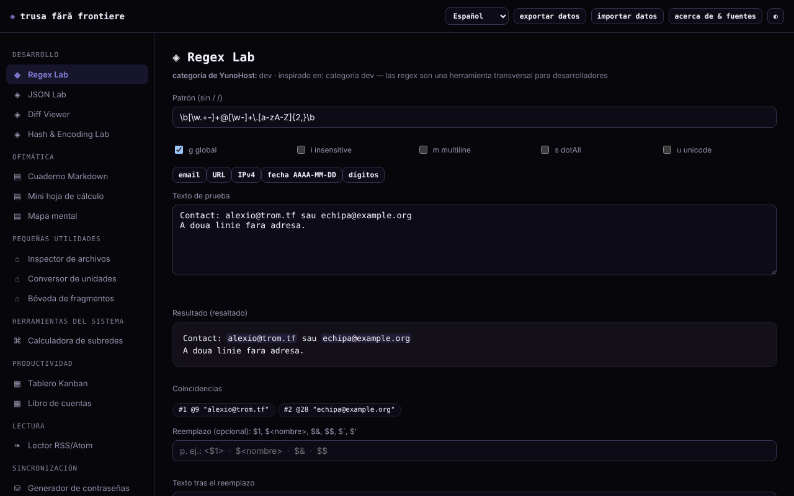

# Trusa fără frontiere

[English](README.md) · [Română](README.ro.md) · [Français](README.fr.md) · [Italiano](README.it.md) · **Español** · [Português](README.pt.md) · [Deutsch](README.de.md) · [Magyar](README.hu.md)

**Versión:** 2.1.0 · **Última actualización:** 2026-10-27

Idiomas de la interfaz: **Română, English, Français, Italiano, Español, Português (PT), Deutsch, Magyar**

Un kit de 15 pequeñas herramientas en un único archivo HTML: regex, JSON, diff, hash, contraseñas, subred, notas, hoja de cálculo, Kanban y otras. Se ejecuta en local en el navegador, sin cuenta.

**Aplicación en línea:** https://chiuta.github.io/Trusa-fara-frontiere/

## Qué es

Un conjunto de pequeños módulos, escritos desde cero, inspirados en la funcionalidad básica de algunas categorías de aplicaciones del catálogo de YunoHost (desarrollo, oficina, utilidades, herramientas de sistema, productividad, lectura). No es una reconstrucción de esas aplicaciones ni está afiliado a YunoHost; las aplicaciones que dependen de un servidor (chat, sincronización, redes sociales) no tienen equivalente en un archivo local.

## Funciones

Verificadas en el código y probadas en Chromium sin interfaz:
- **Regex Lab**: coincidencias resaltadas, grupos (incluidos los con nombre), indicadores g/i/m/s/u, vista previa de sustitución (`$1`, `$<nombre>`, `$&`, `$$`, `` $` ``, `$'`); se ejecuta en un Worker con un límite de 1,5 s, para que un patrón con retroceso catastrófico no bloquee la página.
- **JSON Lab**: validación, formateo (2/4 espacios/tabulador), minificación, ordenación recursiva de claves, búsqueda por ruta (`a.b[0].c`) y conversión de una lista de objetos → CSV.
- **Diff Viewer**: diferencia por líneas (LCS), con resaltado de las palabras cambiadas en los pares de líneas modificadas, con límite de tamaño.
- **Hash & Encoding Lab**: SHA-1/256/384/512 y HMAC con clave (Web Crypto), verificación de un hash conocido, Base64 (UTF-8), URL-encode, hex.
- **Inspector de archivos**: metadatos, vista previa de imagen, estadísticas de texto, SHA-256, todo en local.
- **Generador de contraseñas**: contraseña de caracteres y frase de contraseña de 150 palabras, con `crypto.getRandomValues` (sin recurrir a `Math.random`) y estimación de entropía.
- **Calculadora de subred** IPv4/CIDR, **Conversor de unidades** (longitud, masa, volumen, datos, temperatura).
- **Cuaderno Markdown** (subconjunto: títulos, listas con viñetas y numeradas, citas, línea horizontal, tablas con `|`, código, enlaces http/https/mailto; «Exportar .md» descarga la nota seleccionada), **Mini hoja de cálculo** (8×20, SUM/AVG/MIN/MAX/COUNT; «Exportar CSV» con los valores calculados e «Importar CSV» con separador coma, punto y coma o tabulador), **Mapa mental** (ratón, tacto, teclado), **Tablero Kanban**, **Diario financiero**, **Bóveda de fragmentos**.
- **Lector RSS/Atom** para archivos XML cargados o pegados (no descarga feeds).
- Exportación/importación JSON de todos los datos locales; tema día/noche.

## Manual de uso

1. Elige un módulo en el menú de la izquierda (en el teléfono, el botón ☰).
2. Introduce los datos en los campos del módulo; los resultados se actualizan al instante (en Diff y Contraseñas pulsas el botón).
3. Las notas, la hoja, el mapa, el Kanban, el diario y los fragmentos se guardan automáticamente en el navegador.
4. Para una copia de seguridad pulsa «exportar datos» (descarga un archivo JSON); «importar datos» lo vuelve a cargar y sustituye los datos de los módulos que encuentre en el archivo, tras confirmación.
5. «acerca de y fuentes» explica el proyecto y sus límites.

## Privacidad y red

- La aplicación no realiza solicitudes de red: la CSP de la página tiene `connect-src 'none'` y `script-src` mediante hash SHA-256 (sin `'unsafe-inline'`), sin scripts, fuentes ni imágenes externos. No hay telemetría, cuenta ni cookies.
- Almacenamiento: `localStorage`, claves con el prefijo `trusa-fara-frontiere.` (`notebook`, `spreadsheet`, `mindmap`, `kanban`, `ledger`, `paste`), **sin cifrar**. Si el almacenamiento está bloqueado (modo privado), la aplicación funciona, pero muestra una advertencia de que los datos no se conservan.
- Hosts externos: ninguno, aparte del enlace a github.com/YunoHost/apps en el cuadro «acerca de» (solo se abre si lo pulsas, con `noopener noreferrer`) y los enlaces de las notas/feeds que pulses tú.
- Permisos del navegador: ninguno. Los archivos elegidos permanecen en el navegador. Se usan un Worker desde un Blob (Regex Lab) y el portapapeles (botones «Copiar»).

## Límites y advertencias

- Los datos de `localStorage` se pierden si borras los datos del sitio o cambias de navegador/dispositivo; haz exportaciones periódicas. Dos pestañas abiertas a la vez pueden sobrescribirse mutuamente.
- No guardes contraseñas, claves ni datos sensibles en el Cuaderno, la hoja o la Bóveda: se almacenan en claro en el navegador.
- Las contraseñas se generan en local, pero no garantizan la presencia de cada tipo de carácter. La frase de contraseña usa una lista pequeña (150 palabras, ≈7,2 bits/palabra): usa 10–12 palabras para algo importante. Los hashes SHA rápidos no son adecuados para almacenar contraseñas; SHA-1 está obsoleto.
- La hoja de cálculo y el Markdown son subconjuntos simples y no sustituyen a programas completos. El diario financiero es un registro personal sencillo, no un software de contabilidad, y no especifica la moneda.
- Los enteros superiores a 2^53 pierden precisión en JSON Lab (límite de JavaScript). Diff rechaza textos muy grandes.
- Los mapas y los módulos se probaron en Chromium; no se probaron otros navegadores.

## Ejecución local / sin conexión

Descarga `index.html` y ábrelo en un navegador; no tiene dependencias. Para un servidor local: `python3 -m http.server`.

## Historial / Changelog

### 1.2.7 — 2026-10-23
- Cuaderno Markdown: las URL con `*` o `` ` `` ya no se deforman (los enlaces se extraen antes del formato).

### 1.2.6 — 2026-10-23

- Las claves del almacenamiento local usan ahora el prefijo `trusa-fara-frontiere.` (`FFF.store.migrate` al arrancar, antes de cualquier lectura): los datos existentes se conservan automáticamente y las copias `.fff.json` antiguas se siguen pudiendo importar.

### 1.2.4 — 2026-10-22
- fff-kit 1.1.4: objetivos táctiles y texto mínimo

### 1.2.3 — 2026-10-22
- fff-kit 1.1.2: PBKDF2 con 600.000 iteraciones, protección anti-clickjacking.

### 1.2.1 — 2026-10-22
- Correcciones de traducción: el título de la página y las metaetiquetas siguen el idioma de la interfaz; los textos de ejemplo de Regex Lab y del Cuaderno están traducidos.

### 1.1.0 — 2026-10-14
- Copia de seguridad y etiquetado de datos (fff-kit).

### 1.0.0 — 12 de octubre de 2026
- La versión y la fecha de la última actualización se muestran en la aplicación (ventana «acerca de y fuentes»).

### 11.10.2026 (tercera actualización) — 11 de octubre de 2026
- Regex Lab: vista previa de sustitución (construida a partir de las coincidencias halladas en el Worker, por lo que conserva el límite de 1,5 s), grupos con nombre e indicador `u`.
- JSON Lab: búsqueda por ruta y lista de objetos → CSV. Diff Viewer: las palabras cambiadas se resaltan dentro de las líneas modificadas. Hash & Encoding Lab: HMAC con clave y verificación de un hash conocido.

### 11.10.2026 (segunda actualización) — 11 de octubre de 2026
- Seguridad: `script-src` en la CSP usa un hash SHA-256 en lugar de `'unsafe-inline'`.
- Cuaderno: tablas Markdown, listas numeradas, línea horizontal y «Exportar .md». Hoja de cálculo: «Exportar CSV» (con protección contra fórmulas en otros programas: los valores de texto que empiezan por `=`, `+`, `-`, `@` reciben un apóstrofo) e «Importar CSV» (máx. 8 columnas × 20 filas, con confirmación).
- Estilo de impresión: solo se imprime el módulo actual, sobre fondo blanco.

### 11.10.2026 — 11 de octubre de 2026
- Verificación de rutina del 11.10.2026: axe sin infracciones a 1280 y 360 px, sin errores de consola; sin cambios de código.

## Licencia

MIT — véase el archivo LICENSE.

## Autor

Alexio — Alexandru-Ionuț Chiuță, contacto: alexio@trom.tf. Construido con Claude (Anthropic) a petición del autor.

## Resumen

Trusa fără frontiere («Kit sin fronteras») es un kit de un solo archivo, en lengua rumana, con 15 pequeñas herramientas sin conexión: probador de regex (Worker con tiempo límite), JSON, diff, hash/codificación, inspector de archivos, generador de contraseñas y frases de contraseña CSPRNG, calculadora de subred, conversor de unidades, cuaderno Markdown, mini hoja de cálculo, mapa mental, Kanban, diario financiero, bóveda de fragmentos y lector de archivos RSS/Atom. Sin solicitudes de red (CSP `connect-src 'none'`), sin telemetría; los datos permanecen sin cifrar en `localStorage`, con exportación/importación JSON. Licencia: MIT (véase el archivo LICENSE).
