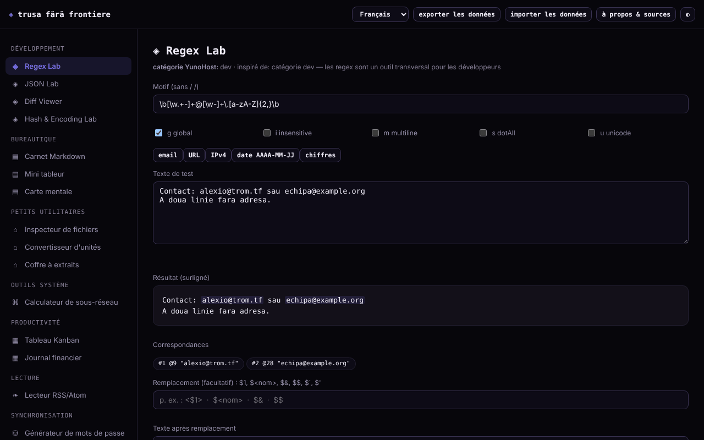

# Trusa fără frontiere

[English](README.md) · [Română](README.ro.md) · **Français** · [Italiano](README.it.md) · [Español](README.es.md) · [Português](README.pt.md) · [Deutsch](README.de.md) · [Magyar](README.hu.md)

**Version :** 1.2.2 · **Dernière mise à jour :** 2026-10-22

Langues de l'interface : **Română, English, Français, Italiano, Español, Português (PT), Deutsch, Magyar**

Une trousse de 15 petits outils dans un seul fichier HTML : regex, JSON, diff, hash, mots de passe, sous-réseau, notes, tableur, Kanban et d'autres. Elle s'exécute localement dans le navigateur, sans compte.

**Application en ligne :** https://chiuta.github.io/Trusa-fara-frontiere/

## Ce que c'est

Un ensemble de petits modules, écrits de zéro, inspirés de la fonctionnalité de base de certaines catégories d'applications du catalogue YunoHost (dev, bureau, utilitaires, outils système, productivité, lecture). Ce n'est pas une reconstruction de ces applications et il n'est pas affilié à YunoHost ; les applications qui dépendent d'un serveur (chat, synchronisation, social) n'ont pas d'équivalent dans un fichier local.

## Fonctions

Vérifiées dans le code et testées dans Chromium sans interface :
- **Regex Lab** : correspondances surlignées, groupes (y compris nommés), drapeaux g/i/m/s/u, aperçu du remplacement (`$1`, `$<nom>`, `$&`, `$$`, `` $` ``, `$'`) ; s'exécute dans un Worker avec une limite de 1,5 s, afin qu'un motif à rétro-traçage catastrophique ne bloque pas la page.
- **JSON Lab** : validation, mise en forme (2/4 espaces/tabulation), minification, tri récursif des clés, recherche par chemin (`a.b[0].c`) et conversion d'une liste d'objets → CSV.
- **Diff Viewer** : différence par lignes (LCS), avec mise en évidence des mots modifiés dans les paires de lignes modifiées, avec une limite de taille.
- **Hash & Encoding Lab** : SHA-1/256/384/512 et HMAC avec clé (Web Crypto), vérification d'un hash connu, Base64 (UTF-8), URL-encode, hex.
- **Inspecteur de fichiers** : métadonnées, aperçu d'image, statistiques de texte, SHA-256, le tout en local.
- **Générateur de mots de passe** : mot de passe à base de caractères et phrase secrète de 150 mots, avec `crypto.getRandomValues` (sans repli sur `Math.random`) et estimation de l'entropie.
- **Calculateur de sous-réseau** IPv4/CIDR, **Convertisseur d'unités** (longueur, masse, volume, données, température).
- **Bloc-notes Markdown** (sous-ensemble : titres, listes à puces et numérotées, citations, ligne horizontale, tableaux avec `|`, code, liens http/https/mailto ; « Exporter .md » télécharge la note sélectionnée), **Mini tableur** (8×20, SUM/AVG/MIN/MAX/COUNT ; « Exporter CSV » avec les valeurs calculées et « Importer CSV » avec séparateur virgule, point-virgule ou tabulation), **Carte mentale** (souris, toucher, clavier), **Tableau Kanban**, **Journal financier**, **Coffre de fragments**.
- **Lecteur RSS/Atom** pour des fichiers XML téléversés ou collés (il ne télécharge pas de flux).
- Export/import JSON de toutes les données locales ; thème jour/nuit.

## Mode d'emploi

1. Choisissez un module dans le menu de gauche (sur téléphone, le bouton ☰).
2. Saisissez les données dans les champs du module ; les résultats se mettent à jour immédiatement (dans Diff et Mots de passe, vous appuyez sur le bouton).
3. Les notes, le tableur, la carte, le Kanban, le journal et les fragments sont enregistrés automatiquement dans le navigateur.
4. Pour une sauvegarde, appuyez sur « exporter les données » (télécharge un fichier JSON) ; « importer les données » le recharge et remplace les données des modules trouvés dans le fichier, après confirmation.
5. « à propos et sources » explique le projet et ses limites.

## Confidentialité et réseau

- L'application n'effectue aucune requête réseau : la CSP de la page a `connect-src 'none'` et `script-src` par hash SHA-256 (sans `'unsafe-inline'`), sans scripts, polices ni images externes. Il n'y a ni télémétrie, ni compte, ni cookies.
- Stockage : `localStorage`, clés avec le préfixe `tff:` (`notebook`, `spreadsheet`, `mindmap`, `kanban`, `ledger`, `paste`), **non chiffré**. Si le stockage est bloqué (mode privé), l'application fonctionne mais affiche un avertissement indiquant que les données ne sont pas conservées.
- Hôtes externes : aucun, hormis le lien vers github.com/YunoHost/apps dans la boîte de dialogue « à propos » (il ne s'ouvre que si vous l'actionnez, avec `noopener noreferrer`) et les liens des notes/flux sur lesquels vous cliquez vous-même.
- Permissions du navigateur : aucune. Les fichiers choisis restent dans le navigateur. Sont utilisés un Worker depuis un Blob (Regex Lab) et le presse-papiers (boutons « Copier »).

## Limites et avertissements

- Les données du `localStorage` sont perdues si vous effacez les données du site ou changez de navigateur/appareil ; faites des exports périodiques. Deux onglets ouverts simultanément peuvent s'écraser mutuellement.
- Ne conservez pas de mots de passe, de clés ou de données sensibles dans le Bloc-notes, le tableur ou le Coffre : ils sont stockés en clair dans le navigateur.
- Les mots de passe sont générés localement, mais ne garantissent pas la présence de chaque type de caractère. La phrase secrète utilise une petite liste (150 mots, ≈7,2 bits/mot) : utilisez 10 à 12 mots pour quelque chose d'important. Les hash SHA rapides ne conviennent pas au stockage de mots de passe ; SHA-1 est obsolète.
- Le tableur et le Markdown sont de simples sous-ensembles et ne remplacent pas des programmes complets. Le journal financier est une comptabilité personnelle simple, pas un logiciel comptable, et ne précise pas la devise.
- Les entiers supérieurs à 2^53 perdent en précision dans JSON Lab (limite de JavaScript). Diff refuse les textes très volumineux.
- Les cartes et les modules ont été testés dans Chromium ; les autres navigateurs n'ont pas été testés.

## Exécution locale / hors ligne

Téléchargez `index.html` et ouvrez-le dans un navigateur ; il n'a aucune dépendance. Pour un serveur local : `python3 -m http.server`.

## Historique / Changelog

### 1.2.1 — 2026-10-22
- Corrections de traduction : le titre de la page et les balises meta suivent la langue de l’interface ; les textes d’exemple de Regex Lab et du Carnet sont traduits.

### 1.1.0 — 2026-10-14
- Sauvegarde et étiquetage des données (fff-kit).

### 1.0.0 — 12 octobre 2026
- La version et la date de la dernière mise à jour sont affichées dans l'application (fenêtre « à propos et sources »).

### 11.10.2026 (troisième mise à jour) — 11 octobre 2026
- Regex Lab : aperçu du remplacement (construit à partir des correspondances trouvées dans le Worker, il conserve donc la limite de 1,5 s), groupes nommés et drapeau `u`.
- JSON Lab : recherche par chemin et liste d'objets → CSV. Diff Viewer : les mots modifiés sont surlignés à l'intérieur des lignes modifiées. Hash & Encoding Lab : HMAC avec clé et vérification d'un hash connu.

### 11.10.2026 (deuxième mise à jour) — 11 octobre 2026
- Sécurité : le `script-src` de la CSP utilise un hash SHA-256 au lieu de `'unsafe-inline'`.
- Bloc-notes : tableaux Markdown, listes numérotées, ligne horizontale et « Exporter .md ». Tableur : « Exporter CSV » (avec protection contre les formules dans d'autres programmes : les valeurs texte commençant par `=`, `+`, `-`, `@` reçoivent une apostrophe) et « Importer CSV » (max. 8 colonnes × 20 lignes, avec confirmation).
- Style d'impression : seul le module courant est imprimé, sur fond blanc.

### 11.10.2026 — 11 octobre 2026
- Vérification de routine du 11.10.2026 : axe sans violation à 1280 et 360 px, aucune erreur de console ; aucune modification du code.

## Licence

MIT — voir le fichier LICENSE.

## Auteur

Alexio — Alexandru-Ionuț Chiuță, contact : alexio@trom.tf. Construit avec Claude (Anthropic) à la demande de l'auteur.

## Résumé

Trusa fără frontiere (« Trousse sans frontières ») est une trousse monofichier, en langue roumaine, de 15 petits outils hors ligne : testeur de regex (Worker avec délai), JSON, diff, hash/encodage, inspecteur de fichiers, générateur de mots de passe et de phrases secrètes CSPRNG, calculateur de sous-réseau, convertisseur d'unités, bloc-notes Markdown, mini tableur, carte mentale, Kanban, journal financier, coffre de fragments et lecteur de fichiers RSS/Atom. Aucune requête réseau (CSP `connect-src 'none'`), aucune télémétrie ; les données restent non chiffrées dans `localStorage`, avec export/import JSON. Licence : MIT (voir le fichier LICENSE).
