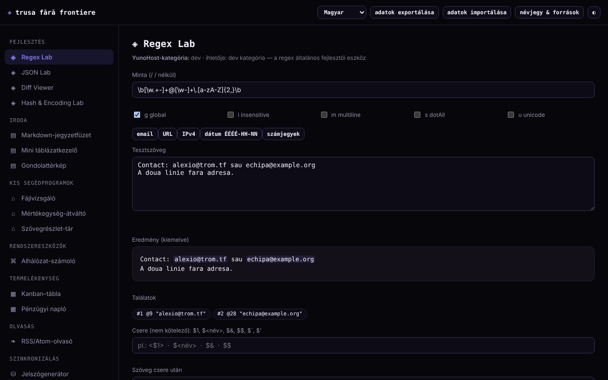

# Trusa fără frontiere

[English](README.md) · [Română](README.ro.md) · [Français](README.fr.md) · [Italiano](README.it.md) · [Español](README.es.md) · [Português](README.pt.md) · [Deutsch](README.de.md) · **Magyar**

**Verzió:** 1.2.5 · **Utolsó frissítés:** 2026-10-23

A felület nyelvei: **Română, English, Français, Italiano, Español, Português (PT), Deutsch, Magyar**

15 apró eszközből álló készlet egyetlen HTML-fájlban: regex, JSON, diff, hash, jelszavak, alhálózat, jegyzetek, táblázatkezelő, Kanban és mások. Helyben fut a böngészőben, fiók nélkül.

**Online alkalmazás:** https://chiuta.github.io/Trusa-fara-frontiere/

## Mi ez

Kis modulok gyűjteménye, a nulláról megírva, a YunoHost-katalógus egyes alkalmazáskategóriáinak alapfunkcióiból inspirálódva (fejlesztés, iroda, segédprogramok, rendszereszközök, termelékenység, olvasás). Nem ezeknek az alkalmazásoknak az újraépítése, és nem áll kapcsolatban a YunoHosttal; a szerverfüggő alkalmazásoknak (csevegés, szinkronizálás, közösségi) nincs megfelelőjük egy helyi fájlban.

## Funkciók

A kódban ellenőrizve és fej nélküli Chromiumban tesztelve:
- **Regex Lab**: kiemelt találatok, csoportok (a nevesítettek is), g/i/m/s/u jelzők, a csere előnézete (`$1`, `$<név>`, `$&`, `$$`, `` $` ``, `$'`); Workerben fut 1,5 másodperces korláttal, hogy egy katasztrofális visszalépéses minta ne blokkolja az oldalt.
- **JSON Lab**: érvényesítés, formázás (2/4 szóköz/tabulátor), minifikálás, a kulcsok rekurzív rendezése, keresés útvonal szerint (`a.b[0].c`) és objektumlista → CSV átalakítás.
- **Diff Viewer**: soronkénti különbség (LCS), a módosított sorpárokban a megváltozott szavak kiemelésével, méretkorláttal.
- **Hash & Encoding Lab**: SHA-1/256/384/512 és kulcsos HMAC (Web Crypto), ismert hash ellenőrzése, Base64 (UTF-8), URL-encode, hex.
- **Fájlvizsgáló**: metaadatok, képelőnézet, szövegstatisztika, SHA-256, minden helyben.
- **Jelszógenerátor**: karakteres jelszó és 150 szavas jelmondat, `crypto.getRandomValues` használatával (a `Math.random`-ra való visszalépés nélkül) és entrópiabecsléssel.
- **IPv4/CIDR alhálózat-számoló**, **Mértékegység-átváltó** (hossz, tömeg, térfogat, adat, hőmérséklet).
- **Markdown jegyzetfüzet** (részhalmaz: címsorok, felsorolásos és számozott listák, idézetek, vízszintes vonal, `|` jelű táblázatok, kód, http/https/mailto hivatkozások; a „.md exportálása” letölti a kijelölt jegyzetet), **Mini táblázatkezelő** (8×20, SUM/AVG/MIN/MAX/COUNT; „CSV exportálása” a kiszámított értékekkel és „CSV importálása” vessző, pontosvessző vagy tabulátor elválasztóval), **Gondolattérkép** (egér, érintés, billentyűzet), **Kanban-tábla**, **Pénzügyi napló**, **Szövegrészlet-trezor**.
- **RSS/Atom olvasó** feltöltött vagy beillesztett XML-fájlokhoz (nem tölt le hírcsatornákat).
- Az összes helyi adat JSON-exportja/-importja; nappali/éjszakai téma.

## Használati útmutató

1. Válassz egy modult a bal oldali menüből (telefonon a ☰ gomb).
2. Add meg az adatokat a modul mezőiben; az eredmények azonnal frissülnek (a Diffnél és a Jelszavaknál megnyomod a gombot).
3. A jegyzetek, a táblázat, a gondolattérkép, a Kanban, a napló és a szövegrészletek automatikusan mentődnek a böngészőben.
4. Biztonsági mentéshez nyomd meg az „adatok exportálása” gombot (JSON-fájlt tölt le); az „adatok importálása” visszatölti, és megerősítés után lecseréli a fájlban talált modulok adatait.
5. Az „névjegy és források” elmagyarázza a projektet és a korlátait.

## Adatvédelem és hálózat

- Az alkalmazás nem küld hálózati kéréseket: az oldal CSP-jében `connect-src 'none'` és SHA-256 hash alapú `script-src` van (`'unsafe-inline'` nélkül), külső szkriptek, betűtípusok vagy képek nélkül. Nincs telemetria, fiók vagy süti.
- Tárolás: `localStorage`, `tff:` előtagú kulcsok (`notebook`, `spreadsheet`, `mindmap`, `kanban`, `ledger`, `paste`), **titkosítatlanul**. Ha a tárolás le van tiltva (privát mód), az alkalmazás működik, de figyelmeztet, hogy az adatok nem maradnak meg.
- Külső hosztok: nincs, kivéve a github.com/YunoHost/apps hivatkozást a „névjegy” párbeszédablakban (csak akkor nyílik meg, ha rákattintasz, `noopener noreferrer` beállítással) és a jegyzetekben/hírcsatornákban lévő hivatkozásokat, amelyekre te kattintasz.
- Böngészőengedélyek: nincs. A kiválasztott fájlok a böngészőben maradnak. Blobból létrehozott Workert (Regex Lab) és vágólapot („Másolás” gombok) használ.

## Korlátok és figyelmeztetések

- A `localStorage` adatai elvesznek, ha törlöd a webhely adatait, vagy böngészőt/eszközt váltasz; exportálj rendszeresen. Két egyidejűleg megnyitott lap felülírhatja egymást.
- Ne tarts jelszavakat, kulcsokat vagy érzékeny adatokat a Jegyzetfüzetben, a táblázatban vagy a Trezorban: ezek egyszerű szövegként tárolódnak a böngészőben.
- A jelszavak helyben generálódnak, de nem garantálják, hogy minden karaktertípus előfordul. A jelmondat kis listát használ (150 szó, ≈7,2 bit/szó): fontos dologhoz használj 10–12 szót. A gyors SHA-hashek nem alkalmasak jelszavak tárolására; az SHA-1 elavult.
- A táblázatkezelő és a Markdown egyszerű részhalmazok, nem helyettesítenek teljes programokat. A pénzügyi napló egyszerű személyes nyilvántartás, nem könyvelőprogram, és nem határozza meg a pénznemet.
- A 2^53 feletti egész számok elveszítik a pontosságukat a JSON Labban (JavaScript-korlát). A Diff nagyon nagy szövegeket elutasít.
- A térképeket és a modulokat Chromiumban tesztelték; más böngészőket nem teszteltek.

## Helyi / offline futtatás

Töltsd le az `index.html` fájlt, és nyisd meg egy böngészőben; nincsenek függőségei. Helyi szerverhez: `python3 -m http.server`.

## Előzmények / Changelog

### 1.2.4 — 2026-10-22
- fff-kit 1.1.4: érintési célpontok és minimális szövegméret

### 1.2.3 — 2026-10-22
- fff-kit 1.1.2: PBKDF2 600 000 iterációval, clickjacking elleni védelem.

### 1.2.1 — 2026-10-22
- Fordítási javítások: az oldalcím és a meta címkék követik a felület nyelvét; a Regex Lab és a Jegyzetfüzet mintaszövegei le vannak fordítva.

### 1.1.0 — 2026-10-14
- Biztonsági mentés és az adatok címkézése (fff-kit).

### 1.0.0 — 2026. október 12.
- A verzió és az utolsó frissítés dátuma megjelenik az alkalmazásban („névjegy és források” ablak).

### 2026.10.11. (harmadik frissítés) — 2026. október 11.
- Regex Lab: a csere előnézete (a Workerben talált találatokból épül fel, így megtartja az 1,5 másodperces korlátot), nevesített csoportok és az `u` jelző.
- JSON Lab: keresés útvonal szerint és objektumlista → CSV. Diff Viewer: a megváltozott szavak ki vannak emelve a módosított soron belül. Hash & Encoding Lab: kulcsos HMAC és ismert hash ellenőrzése.

### 2026.10.11. (második frissítés) — 2026. október 11.
- Biztonság: a CSP `script-src` irányelve SHA-256 hasht használ az `'unsafe-inline'` helyett.
- Jegyzetfüzet: Markdown-táblázatok, számozott listák, vízszintes vonal és „.md exportálása”. Táblázatkezelő: „CSV exportálása” (más programokban védelemmel a képletek ellen: az `=`, `+`, `-`, `@` jellel kezdődő szövegértékek aposztrófot kapnak) és „CSV importálása” (legfeljebb 8 oszlop × 20 sor, megerősítéssel).
- Nyomtatási stílus: csak az aktuális modul nyomtatódik, fehér háttéren.

### 2026.10.11. — 2026. október 11.
- Rutinellenőrzés 2026.10.11-én: axe szabálysértés nélkül 1280 és 360 px szélességen, konzolhibák nélkül; kódmódosítás nem történt.

## Licenc

MIT — lásd a LICENSE fájlt.

## Szerző

Alexio — Alexandru-Ionuț Chiuță, elérhetőség: alexio@trom.tf. A szerző kérésére Claude (Anthropic) segítségével készült.

## Összefoglaló

A Trusa fără frontiere („Határok nélküli készlet”) egy egyfájlos, román nyelvű készlet 15 kis offline eszközzel: regextesztelő (Worker időkorláttal), JSON, diff, hash/kódolás, fájlvizsgáló, CSPRNG jelszó- és jelmondatgenerátor, alhálózat-számoló, mértékegység-átváltó, Markdown jegyzetfüzet, mini táblázatkezelő, gondolattérkép, Kanban, pénzügyi napló, szövegrészlet-trezor és RSS/Atom-fájlolvasó. Nincsenek hálózati kérések (CSP `connect-src 'none'`), nincs telemetria; az adatok titkosítatlanul maradnak a `localStorage`-ban, JSON-exporttal/-importtal. Licenc: MIT (lásd a LICENSE fájlt).
