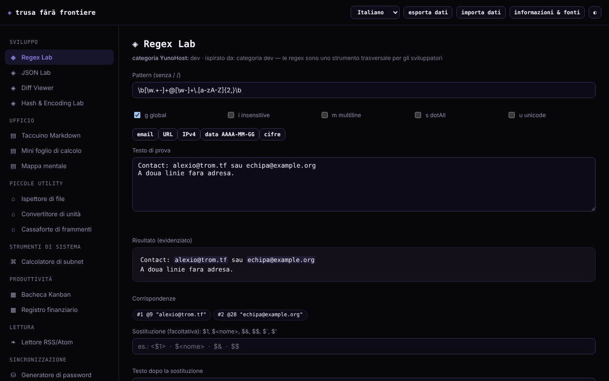

# Trusa fără frontiere

[English](README.md) · [Română](README.ro.md) · [Français](README.fr.md) · **Italiano** · [Español](README.es.md) · [Português](README.pt.md) · [Deutsch](README.de.md) · [Magyar](README.hu.md)

**Versione:** 1.2.0 · **Ultimo aggiornamento:** 2026-10-19

Lingue dell'interfaccia: **Română, English, Français, Italiano, Español, Português (PT), Deutsch, Magyar**

Un kit di 15 piccoli strumenti in un unico file HTML: regex, JSON, diff, hash, password, subnet, appunti, foglio di calcolo, Kanban e altri. Funziona in locale nel browser, senza account.

**Applicazione online:** https://chiuta.github.io/Trusa-fara-frontiere/

## Che cos'è

Un insieme di piccoli moduli, scritti da zero, ispirati alla funzionalità di base di alcune categorie di applicazioni del catalogo YunoHost (dev, ufficio, utilità, strumenti di sistema, produttività, lettura). Non è una ricostruzione di quelle applicazioni e non è affiliato a YunoHost; le applicazioni che dipendono da un server (chat, sincronizzazione, social) non hanno equivalente in un file locale.

## Funzioni

Verificate nel codice e testate in Chromium headless:
- **Regex Lab**: corrispondenze evidenziate, gruppi (anche con nome), flag g/i/m/s/u, anteprima della sostituzione (`$1`, `$<nome>`, `$&`, `$$`, `` $` ``, `$'`); gira in un Worker con limite di 1,5 s, così un pattern con backtracking catastrofico non blocca la pagina.
- **JSON Lab**: validazione, formattazione (2/4 spazi/tab), minificazione, ordinamento ricorsivo delle chiavi, ricerca per percorso (`a.b[0].c`) e conversione di un elenco di oggetti → CSV.
- **Diff Viewer**: differenza per righe (LCS), con evidenziazione delle parole modificate nelle coppie di righe modificate, con limite di dimensione.
- **Hash & Encoding Lab**: SHA-1/256/384/512 e HMAC con chiave (Web Crypto), verifica di un hash noto, Base64 (UTF-8), URL-encode, hex.
- **Ispettore di file**: metadati, anteprima dell'immagine, statistiche del testo, SHA-256, tutto in locale.
- **Generatore di password**: password a caratteri e passphrase di 150 parole, con `crypto.getRandomValues` (senza ripiego su `Math.random`) e stima dell'entropia.
- **Calcolatore di subnet** IPv4/CIDR, **Convertitore di unità** (lunghezza, massa, volume, dati, temperatura).
- **Taccuino Markdown** (sottoinsieme: titoli, elenchi puntati e numerati, citazioni, linea orizzontale, tabelle con `|`, codice, link http/https/mailto; «Esporta .md» scarica la nota selezionata), **Mini foglio di calcolo** (8×20, SUM/AVG/MIN/MAX/COUNT; «Esporta CSV» con i valori calcolati e «Importa CSV» con separatore virgola, punto e virgola o tab), **Mappa mentale** (mouse, tocco, tastiera), **Lavagna Kanban**, **Registro finanziario**, **Vault di frammenti**.
- **Lettore RSS/Atom** per file XML caricati o incollati (non scarica feed).
- Esportazione/importazione JSON di tutti i dati locali; tema giorno/notte.

## Guida all'uso

1. Scegli un modulo dal menu a sinistra (su telefono, il pulsante ☰).
2. Inserisci i dati nei campi del modulo; i risultati si aggiornano subito (in Diff e Password premi il pulsante).
3. Appunti, foglio, mappa, Kanban, registro e frammenti vengono salvati automaticamente nel browser.
4. Per una copia di riserva premi «esporta dati» (scarica un file JSON); «importa dati» lo ricarica e sostituisce i dati dei moduli trovati nel file, dopo conferma.
5. «informazioni e fonti» spiega il progetto e i suoi limiti.

## Privacy e rete

- L'applicazione non effettua richieste di rete: la CSP della pagina ha `connect-src 'none'` e `script-src` tramite hash SHA-256 (senza `'unsafe-inline'`), senza script, font o immagini esterni. Non ci sono telemetria, account o cookie.
- Archiviazione: `localStorage`, chiavi con prefisso `tff:` (`notebook`, `spreadsheet`, `mindmap`, `kanban`, `ledger`, `paste`), **non cifrata**. Se l'archiviazione è bloccata (modalità privata), l'applicazione funziona ma mostra un avviso che i dati non vengono conservati.
- Host esterni: nessuno, a parte il link a github.com/YunoHost/apps nella finestra «informazioni» (si apre solo se lo premi, con `noopener noreferrer`) e i link nelle note/feed su cui clicchi tu.
- Permessi del browser: nessuno. I file scelti restano nel browser. Si usano un Worker da Blob (Regex Lab) e gli appunti di sistema (pulsanti «Copia»).

## Limiti e avvertenze

- I dati in `localStorage` si perdono se cancelli i dati del sito o cambi browser/dispositivo; esporta periodicamente. Due schede aperte contemporaneamente possono sovrascriversi a vicenda.
- Non conservare password, chiavi o dati sensibili nel Taccuino, nel foglio o nel Vault: sono salvati in chiaro nel browser.
- Le password sono generate in locale, ma non garantiscono la presenza di ogni tipo di carattere. La passphrase usa un elenco ridotto (150 parole, ≈7,2 bit/parola): usa 10–12 parole per qualcosa di importante. Gli hash SHA veloci non sono adatti alla conservazione delle password; SHA-1 è obsoleto.
- Il foglio di calcolo e il Markdown sono semplici sottoinsiemi e non sostituiscono programmi completi. Il registro finanziario è una semplice contabilità personale, non un software contabile, e non specifica la valuta.
- Gli interi oltre 2^53 perdono precisione in JSON Lab (limite di JavaScript). Diff rifiuta testi molto grandi.
- Le mappe e i moduli sono stati testati in Chromium; gli altri browser non sono stati testati.

## Esecuzione locale / offline

Scarica `index.html` e aprilo in un browser; non ha dipendenze. Per un server locale: `python3 -m http.server`.

## Cronologia / Changelog

### 1.1.0 — 2026-10-14
- Copia di riserva ed etichettatura dei dati (fff-kit).

### 1.0.0 — 12 ottobre 2026
- La versione e la data dell'ultimo aggiornamento sono mostrate nell'applicazione (finestra «informazioni e fonti»).

### 11.10.2026 (terzo aggiornamento) — 11 ottobre 2026
- Regex Lab: anteprima della sostituzione (costruita dalle corrispondenze trovate nel Worker, quindi mantiene il limite di 1,5 s), gruppi con nome e flag `u`.
- JSON Lab: ricerca per percorso ed elenco di oggetti → CSV. Diff Viewer: le parole modificate sono evidenziate all'interno delle righe modificate. Hash & Encoding Lab: HMAC con chiave e verifica di un hash noto.

### 11.10.2026 (secondo aggiornamento) — 11 ottobre 2026
- Sicurezza: `script-src` nella CSP usa un hash SHA-256 invece di `'unsafe-inline'`.
- Taccuino: tabelle Markdown, elenchi numerati, linea orizzontale e «Esporta .md». Foglio di calcolo: «Esporta CSV» (con protezione contro le formule in altri programmi: i valori di testo che iniziano con `=`, `+`, `-`, `@` ricevono un apostrofo) e «Importa CSV» (max. 8 colonne × 20 righe, con conferma).
- Stile di stampa: si stampa solo il modulo corrente, su sfondo bianco.

### 11.10.2026 — 11 ottobre 2026
- Verifica di routine dell'11.10.2026: axe senza violazioni a 1280 e 360 px, nessun errore di console; nessuna modifica al codice.

## Licenza

MIT — vedi il file LICENSE.

## Autore

Alexio — Alexandru-Ionuț Chiuță, contatto: alexio@trom.tf. Costruito con Claude (Anthropic) su richiesta dell'autore.

## Sintesi

Trusa fără frontiere («Kit senza frontiere») è un kit a file singolo, in lingua rumena, di 15 piccoli strumenti offline: tester di regex (Worker con timeout), JSON, diff, hash/codifica, ispettore di file, generatore di password e passphrase CSPRNG, calcolatore di subnet, convertitore di unità, taccuino Markdown, mini foglio di calcolo, mappa mentale, Kanban, registro finanziario, vault di frammenti e lettore di file RSS/Atom. Nessuna richiesta di rete (CSP `connect-src 'none'`), nessuna telemetria; i dati restano non cifrati in `localStorage`, con esportazione/importazione JSON. Licenza: MIT (vedi il file LICENSE).
