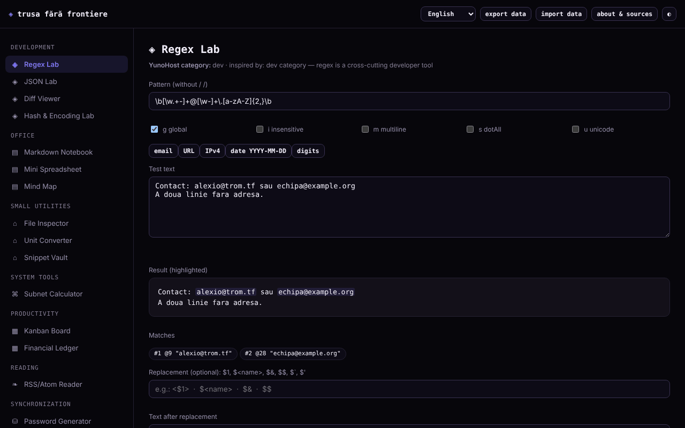

# Trusa fără frontiere

**English** · [Română](README.ro.md) · [Français](README.fr.md) · [Italiano](README.it.md) · [Español](README.es.md) · [Português](README.pt.md) · [Deutsch](README.de.md) · [Magyar](README.hu.md)

**Version:** 1.2.6 · **Last updated:** 2026-10-23

Interface languages: **Română, English, Français, Italiano, Español, Português (PT), Deutsch, Magyar**

A toolkit of 15 small tools in a single HTML file: regex, JSON, diff, hash, passwords, subnet, notes, spreadsheet, Kanban and more. It runs locally in the browser, with no account.

**Live:** https://chiuta.github.io/Trusa-fara-frontiere/

## What it is

A set of small modules, written from scratch, inspired by the core functionality of some categories of applications in the YunoHost catalogue (dev, office, utilities, system tools, productivity, reading). It is not a reconstruction of those applications and is not affiliated with YunoHost; applications that depend on a server (chat, sync, social) have no equivalent in a local file.

## Features

Verified in code and tested in headless Chromium:
- **Regex Lab**: highlighted matches, groups (including named ones), flags g/i/m/s/u, replacement preview (`$1`, `$<name>`, `$&`, `$$`, `` $` ``, `$'`); it runs in a Worker with a 1.5 s limit, so that a pattern with catastrophic backtracking cannot freeze the page.
- **JSON Lab**: validation, formatting (2/4 spaces/tab), minification, recursive key sorting, search by path (`a.b[0].c`) and conversion of a list of objects → CSV.
- **Diff Viewer**: line diff (LCS), with the changed words highlighted in pairs of modified lines, with a size limit.
- **Hash & Encoding Lab**: SHA-1/256/384/512 and keyed HMAC (Web Crypto), verification of a known hash, Base64 (UTF-8), URL-encode, hex.
- **File inspector**: metadata, image preview, text statistics, SHA-256, all local.
- **Password generator**: character-based password and a passphrase from 150 words, with `crypto.getRandomValues` (no fallback to `Math.random`) and an entropy estimate.
- **IPv4/CIDR subnet calculator**, **Unit converter** (length, mass, volume, data, temperature).
- **Markdown notebook** (subset: headings, bulleted and numbered lists, quotes, horizontal rule, tables with `|`, code, http/https/mailto links; "Export .md" downloads the selected note), **Mini spreadsheet** (8×20, SUM/AVG/MIN/MAX/COUNT; "Export CSV" with the computed values and "Import CSV" with comma, semicolon or tab separator), **Mind map** (mouse, touch, keyboard), **Kanban board**, **Financial ledger**, **Snippet vault**.
- **RSS/Atom reader** for uploaded or pasted XML files (it does not download feeds).
- JSON export/import of all local data; day/night theme.

## User guide

1. Choose a module from the menu on the left (on a phone, the ☰ button).
2. Enter data in the module's fields; results update immediately (in Diff and Passwords you press the button).
3. Notes, spreadsheet, mind map, Kanban, ledger and snippets are saved automatically in the browser.
4. For a backup, press "export data" (downloads a JSON file); "import data" reloads it and replaces the data of the modules found in the file, after confirmation.
5. "about & sources" explains the project and its limits.

## Privacy and network

- The app makes no network requests: the page's CSP has `connect-src 'none'` and `script-src` by SHA-256 hash (no `'unsafe-inline'`), with no external scripts, fonts or images. There is no telemetry, account or cookies.
- Storage: `localStorage`, keys with the prefix `trusa-fara-frontiere.` (`notebook`, `spreadsheet`, `mindmap`, `kanban`, `ledger`, `paste`), **unencrypted**. If storage is blocked (private mode), the app works but shows a warning that data is not kept.
- External hosts: none, apart from the link to github.com/YunoHost/apps in the "about" dialog (it opens only if you press it, with `noopener noreferrer`) and the links in notes/feeds that you press yourself.
- Browser permissions: none. The files you choose stay in the browser. A Worker from a Blob (Regex Lab) and the clipboard ("Copy" buttons) are used.

## Limits and warnings

- Data in `localStorage` is lost if you clear the site data or change browser/device; export periodically. Two tabs open at the same time can overwrite each other.
- Do not keep passwords, keys or sensitive data in the Notebook, spreadsheet or Vault: they are stored in plain text in the browser.
- Passwords are generated locally, but they do not guarantee the presence of every character type. The passphrase uses a small list (150 words, ≈7.2 bits/word): use 10–12 words for anything important. Fast SHA hashes are not suitable for storing passwords; SHA-1 is deprecated.
- The spreadsheet and Markdown are simple subsets and do not replace full programs. The financial ledger is simple personal record-keeping, not accounting software, and does not specify the currency.
- Integers above 2^53 lose precision in JSON Lab (a JavaScript limit). Diff refuses very large texts.
- The maps and modules were tested in Chromium; other browsers were not tested.

## Running locally / offline

Download `index.html` and open it in a browser; it has no dependencies. For a local server: `python3 -m http.server`.

## History / Changelog

### 1.2.6 — 2026-10-23

- Local storage keys now use the `trusa-fara-frontiere.` prefix (`FFF.store.migrate` at startup, before any read): existing data is kept automatically, and old `.fff.json` backups can still be imported.

### 1.2.4 — 2026-10-22
- fff-kit 1.1.4: touch targets and minimum text size

### 1.2.3 — 2026-10-22
- fff-kit 1.1.2: PBKDF2 600,000 iterations, anti-clickjacking protection.

### 1.2.1 — 2026-10-22
- Translation fixes: page title and meta tags follow the interface language; the sample texts of Regex Lab and Notebook are now translated.

### 1.1.0 — 2026-10-14
- Backup and data labelling (fff-kit).

### 1.0.0 — 12 October 2026
- The version and the date of the last update are displayed in the app (the "about & sources" window).

### 11.10.2026 (third update) — 11 October 2026
- Regex Lab: replacement preview (built from the matches found in the Worker, so it keeps the 1.5 s limit), named groups and the `u` flag.
- JSON Lab: search by path and list of objects → CSV. Diff Viewer: changed words are highlighted inside modified lines. Hash & Encoding Lab: keyed HMAC and verification of a known hash.

### 11.10.2026 (second update) — 11 October 2026
- Security: `script-src` in the CSP uses a SHA-256 hash instead of `'unsafe-inline'`.
- Notebook: Markdown tables, numbered lists, horizontal rule and "Export .md". Spreadsheet: "Export CSV" (with protection against formulas in other programs: text values starting with `=`, `+`, `-`, `@` get an apostrophe) and "Import CSV" (max. 8 columns × 20 rows, with confirmation).
- Print style: only the current module is printed, on a white background.

### 11.10.2026 — 11 October 2026
- Routine check on 11.10.2026: axe with no violations at 1280 and 360 px, no console errors; no code changes.

## License

MIT — see the LICENSE file.

## Author

Alexio — Alexandru-Ionuț Chiuță, contact: alexio@trom.tf. Built with Claude (Anthropic) at the author's request.

## Summary

Trusa fără frontiere ("Toolkit without borders") is a single-file, Romanian-language toolkit of 15 small offline tools: regex tester (Worker with timeout), JSON, diff, hash/encoding, file inspector, CSPRNG password and passphrase generator, subnet calculator, unit converter, Markdown notebook, mini spreadsheet, mind map, Kanban, ledger, snippet vault and an RSS/Atom file reader. No network requests (CSP `connect-src 'none'`), no telemetry; data stays unencrypted in `localStorage` with JSON export/import. Licence: MIT (see the LICENSE file).
