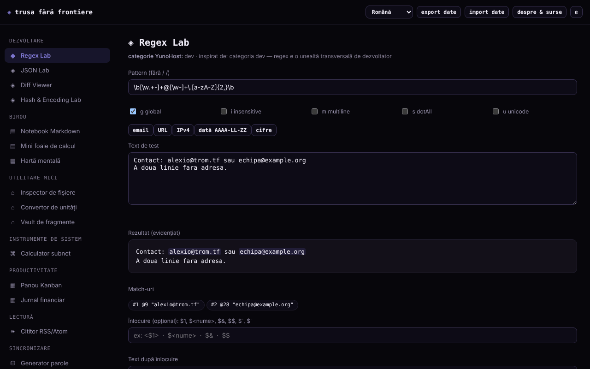

# Trusa fără frontiere

[English](README.md) · **Română** · [Français](README.fr.md) · [Italiano](README.it.md) · [Español](README.es.md) · [Português](README.pt.md) · [Deutsch](README.de.md) · [Magyar](README.hu.md)

**Versiune:** 1.2.5 · **Ultima actualizare:** 2026-10-23

Limbile interfeței: **Română, English, Français, Italiano, Español, Português (PT), Deutsch, Magyar**

Trusă de 15 unelte mici într-un singur fișier HTML: regex, JSON, diff, hash, parole, subnet, notițe, foaie de calcul, Kanban și altele. Rulează local în browser, fără cont.

**Live:** https://chiuta.github.io/Trusa-fara-frontiere/

## Ce este

Un set de module mici, scrise de la zero, inspirate de funcționalitatea de bază a unor categorii de aplicații din catalogul YunoHost (dev, birou, utilitare, instrumente de sistem, productivitate, lectură). Nu este o reconstrucție a acelor aplicații și nu este afiliat YunoHost; aplicațiile care depind de server (chat, sincronizare, social) nu au echivalent într-un fișier local.

## Funcții

Verificate în cod și testate în Chromium headless:
- **Regex Lab**: potriviri evidențiate, grupuri (inclusiv numite), steaguri g/i/m/s/u, previzualizare de înlocuire (`$1`, `$<nume>`, `$&`, `$$`, `` $` ``, `$'`); rulează într-un Worker cu limită de 1,5 s, ca un pattern cu backtracking catastrofal să nu blocheze pagina.
- **JSON Lab**: validare, formatare (2/4 spații/tab), minificare, sortare recursivă a cheilor, căutare după cale (`a.b[0].c`) și conversie listă de obiecte → CSV.
- **Diff Viewer**: diferență pe linii (LCS), cu evidențierea cuvintelor schimbate în perechile de linii modificate, cu limită de dimensiune.
- **Hash & Encoding Lab**: SHA-1/256/384/512 și HMAC cu cheie (Web Crypto), verificarea unui hash cunoscut, Base64 (UTF-8), URL-encode, hex.
- **Inspector de fișiere**: metadate, previzualizare imagine, statistici text, SHA-256, totul local.
- **Generator parole**: parolă pe caractere și pasfrază din 150 de cuvinte, cu `crypto.getRandomValues` (fără rezervă pe `Math.random`) și estimare de entropie.
- **Calculator subnet** IPv4/CIDR, **Convertor de unități** (lungime, masă, volum, date, temperatură).
- **Notebook Markdown** (subset: titluri, liste cu buline și numerotate, citate, linie orizontală, tabele cu `|`, cod, link-uri http/https/mailto; „Export .md” descarcă nota selectată), **Mini foaie de calcul** (8×20, SUM/AVG/MIN/MAX/COUNT; „Export CSV” cu valorile calculate și „Import CSV” cu separator virgulă, punct și virgulă sau tab), **Hartă mentală** (mouse, atingere, tastatură), **Panou Kanban**, **Jurnal financiar**, **Vault de fragmente**.
- **Cititor RSS/Atom** pentru fișiere XML încărcate sau lipite (nu descarcă feed-uri).
- Export/import JSON al tuturor datelor locale; temă zi/noapte.

## Manual de utilizare

1. Alege un modul din meniul din stânga (pe telefon, butonul ☰).
2. Introdu datele în câmpurile modulului; rezultatele se actualizează imediat (la Diff și Parole apeși butonul).
3. Notițele, foaia, harta, Kanban-ul, jurnalul și fragmentele se salvează automat în browser.
4. Pentru copie de rezervă apasă „export date” (descarcă un fișier JSON); „import date” îl reîncarcă și înlocuiește datele modulelor găsite în fișier, după confirmare.
5. „despre & surse” explică proiectul și limitele lui.

## Confidențialitate și rețea

- Aplicația nu face cereri de rețea: CSP din pagină are `connect-src 'none'` și `script-src` pe hash SHA-256 (fără `'unsafe-inline'`), fără scripturi, fonturi sau imagini externe. Nu există telemetrie, cont sau cookie-uri.
- Stocare: `localStorage`, chei cu prefix `tff:` (`notebook`, `spreadsheet`, `mindmap`, `kanban`, `ledger`, `paste`), **necriptat**. Dacă stocarea e blocată (mod privat), aplicația merge, dar afișează un avertisment că datele nu se păstrează.
- Gazde externe: niciuna, în afara linkului către github.com/YunoHost/apps din dialogul „despre” (se deschide doar dacă îl apeși, cu `noopener noreferrer`) și a link-urilor din notițe/feed-uri pe care le apeși tu.
- Permisiuni de browser: niciuna. Fișierele alese rămân în browser. Se folosesc Worker din Blob (Regex Lab) și clipboard (butoanele „Copiază”).

## Limite și avertismente

- Datele din `localStorage` se pierd dacă ștergi datele site-ului sau schimbi browserul/dispozitivul; fă export periodic. Două file deschise simultan se pot suprascrie reciproc.
- Nu păstra parole, chei sau date sensibile în Notebook, foaie sau Vault: sunt stocate în clar în browser.
- Parolele sunt generate local, dar nu garantează prezența fiecărui tip de caractere. Pasfraza folosește o listă mică (150 de cuvinte, ≈7,2 biți/cuvânt): folosește 10–12 cuvinte pentru ceva important. Hash-urile SHA rapide nu sunt potrivite pentru stocarea parolelor; SHA-1 este depășit.
- Foaia de calcul și Markdown sunt subseturi simple, nu înlocuiesc programe complete. Jurnalul financiar este evidență personală simplă, nu software contabil, și nu specifică moneda.
- Numerele întregi peste 2^53 își pierd precizia în JSON Lab (limită JavaScript). Diff-ul refuză texte foarte mari.
- Hărțile și modulele au fost testate în Chromium; alte browsere nu au fost testate.

## Rulare locală / offline

Descarcă `index.html` și deschide-l în browser; nu are dependențe. Pentru server local: `python3 -m http.server`.

## Istoric / Changelog

### 1.2.4 — 2026-10-22
- fff-kit 1.1.4: ținte tactile și text minim

### 1.2.3 — 2026-10-22
- fff-kit 1.1.2: PBKDF2 600 000 de iterații, protecție anti-clickjacking.

### 1.2.1 — 2026-10-22
- Corecturi de traducere: titlul paginii și meta-etichetele urmează limba interfeței; textele-exemplu din Regex Lab și Caiet sunt traduse.

### 1.1.0 — 2026-10-14
- Copie de rezervă și etichetare date (fff-kit).

### 1.0.0 — 12 octombrie 2026
- Versiunea și data ultimei actualizări sunt afișate în aplicație (fereastra „despre & surse”).

### 11.10.2026 (a treia actualizare) — 11 octombrie 2026
- Regex Lab: previzualizare de înlocuire (construită din match-urile găsite în Worker, deci păstrează limita de 1,5 s), grupuri numite și steagul `u`.
- JSON Lab: căutare după cale și listă de obiecte → CSV. Diff Viewer: cuvintele schimbate sunt evidențiate în interiorul liniilor modificate. Hash & Encoding Lab: HMAC cu cheie și verificarea unui hash cunoscut.

### 11.10.2026 (a doua actualizare) — 11 octombrie 2026
- Securitate: `script-src` în CSP folosește hash SHA-256 în loc de `'unsafe-inline'`.
- Notebook: tabele Markdown, liste numerotate, linie orizontală și „Export .md”. Foaie de calcul: „Export CSV” (cu protecție împotriva formulelor în alte programe: valorile text care încep cu `=`, `+`, `-`, `@` primesc un apostrof) și „Import CSV” (max. 8 coloane × 20 rânduri, cu confirmare).
- Stil de tipărire: se tipărește doar modulul curent, pe fundal alb.

### 11.10.2026 — 11 octombrie 2026
- Verificare de rutină la 11.10.2026: axe fără încălcări la 1280 și 360 px, fără erori de consolă; fără modificări de cod.

## Licență

MIT — vezi fișierul LICENSE.

## Autor

Alexio — Alexandru-Ionuț Chiuță, contact: alexio@trom.tf. Construit cu Claude (Anthropic) la cererea autorului.

## Rezumat

Trusa fără frontiere este un set de instrumente într-un singur fișier, în limba română, cu 15 mici instrumente offline: tester regex (Worker cu timeout), JSON, diff, hash/codificare, inspector de fișiere, generator CSPRNG de parole și fraze-parolă, calculator de subrețele, convertor de unități, caiet Markdown, mini foaie de calcul, hartă mentală, Kanban, registru, seif de fragmente și cititor de fișiere RSS/Atom. Fără cereri de rețea (CSP `connect-src 'none'`), fără telemetrie; datele rămân necriptate în `localStorage`, cu export/import JSON. Licență: MIT (vezi fișierul LICENSE).
